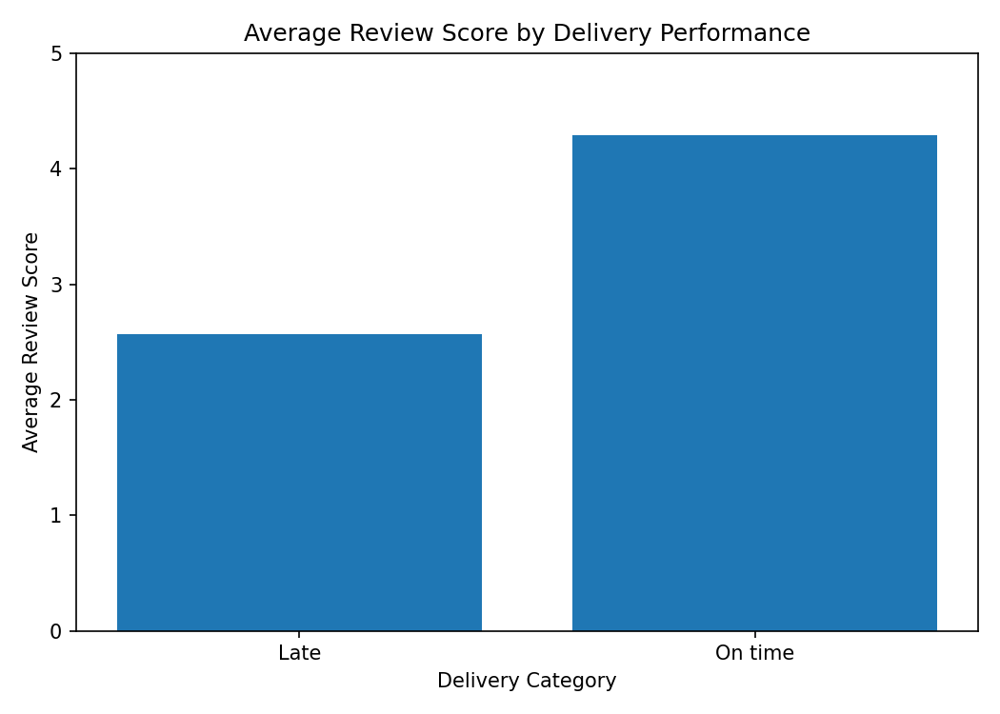
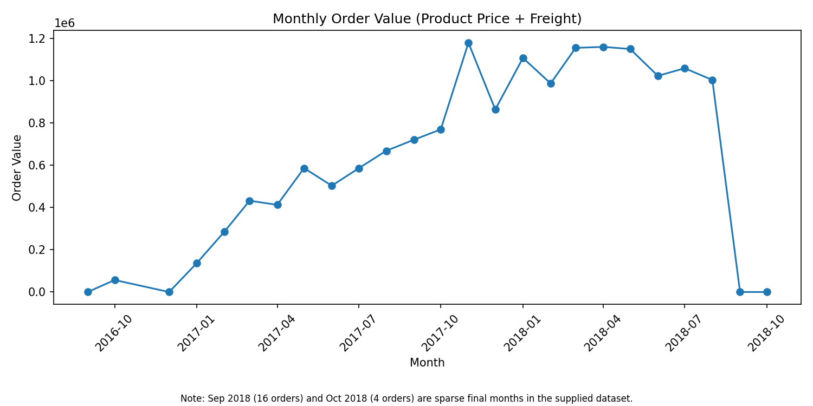
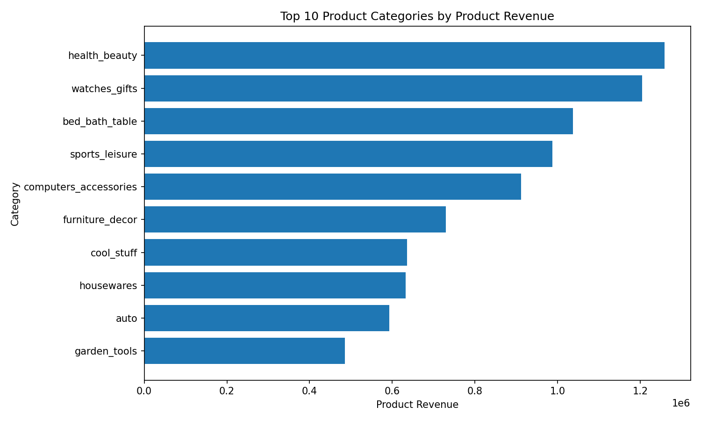
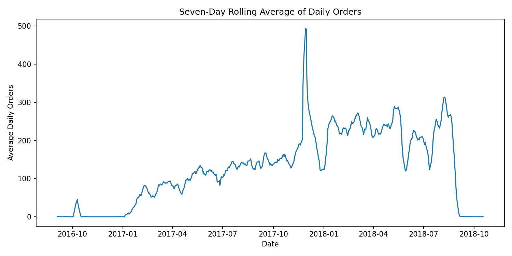

# Weekly Business Review for an E-commerce Marketplace

## 1. Executive Summary

This project analyzes the Olist Brazilian E-Commerce dataset using Python, PostgreSQL, and SQL. The objective is to assess delivery reliability, customer experience, order value, product-category performance, and repeat purchasing.

The analysis contains 99,441 orders, with 99,441 distinct order IDs in the analysis mart. The on-time delivery rate is 91.89%, the late-delivery rate is 8.11%, and the average review score is 4.09 out of 5. The average order value, including product price and freight, is 159.33.

## 2. Data Pipeline and Methodology

The workflow consists of four stages:

1. **Raw ingestion:** Load the source CSV files into PostgreSQL's `raw` schema.
2. **Staging:** Select relevant fields, convert timestamps and numeric values, and filter selected invalid or missing values.
3. **Analysis mart:** Aggregate order items, payments, and reviews before joining them to orders, producing one row per order.
4. **Business analysis:** Use SQL queries and Python-generated charts to evaluate trends and operational performance.

The mart was verified to contain 99,441 rows and 99,441 distinct order IDs.

## 3. ## Data Quality Checks

Nine data-quality checks were executed on the Olist dataset.

| Check | Failed rows | Handling |
|---|---:|---|
| Missing order IDs | 0 | Passed |
| Duplicate order IDs | 0 | Passed |
| Invalid delivery dates | 0 | Passed |
| Invalid order items | 0 | Passed |
| Missing customers | 0 | Passed |
| Invalid review scores | 0 | Passed |
| Payment mismatches | 267 | Flagged for investigation |
| Orders without items | 775 | Flagged for investigation |
| Orders without payments | 1 | Flagged for investigation |

The six critical checks passed without failures. Payment mismatches, orders without items, and orders without payments were reported as warnings, and the pipeline continued. The 775 orders without items were largely associated with unavailable or canceled statuses. The single order without a payment record requires investigation. These exceptions were not silently deleted or corrected.

The pipeline completed successfully and created 99,441 mart rows with 99,441 distinct order IDs. The three warning checks remain unresolved and should be investigated before using the affected records for operational decisions.

## 4. Business Metrics and Analysis

The North Star metric is the on-time delivery rate.

| Metric | Result |
|---|---:|
| On-time delivery rate | 91.89% |
| Late delivery rate | 8.11% |
| Average review score | 4.09/5 |
| Average order value | 159.33 |
| Repeat purchase rate | 3.12% |
| Repeat-customer order share | 6.38% |

The repeat purchase rate measures the percentage of unique customers who placed more than one order. Repeat-customer order share measures the percentage of orders associated with repeat customers. These measures have different denominators.

The analysis also includes monthly order value and growth, the top three product categories by state, a seven-day rolling average of daily orders, and review scores grouped by delivery performance.

**Figure 1.** Monthly order value and month-over-month growth.  
**Figure 2.** Top product categories by product revenue.  
**Figure 3.** Seven-day rolling average of daily orders.  
**Figure 4.** Average review score by delivery performance.

## 5. Recommendations and Conclusion

First, investigate the 8.11% late-delivery rate by state, seller, and product category to identify where operational improvements may have the greatest impact. Second, monitor on-time delivery and review scores together to evaluate whether service improvements coincide with better customer feedback. Third, examine repeat purchasing by customer segment and consider targeted retention initiatives.

The current results establish a baseline for future weekly business reviews. Before operational decisions are made, the data-quality exceptions should be investigated and the pipeline should be validated end to end.
   